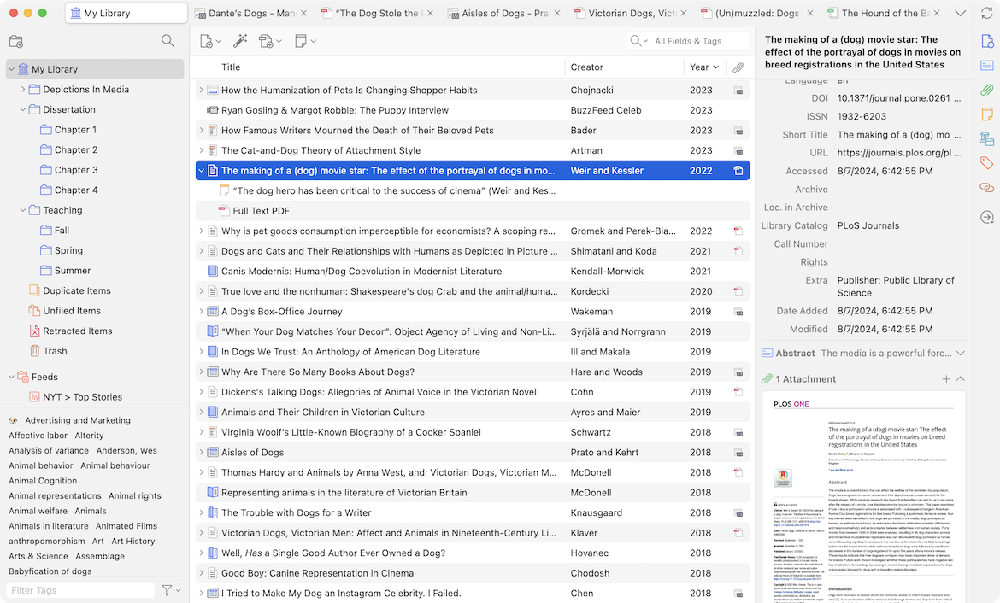
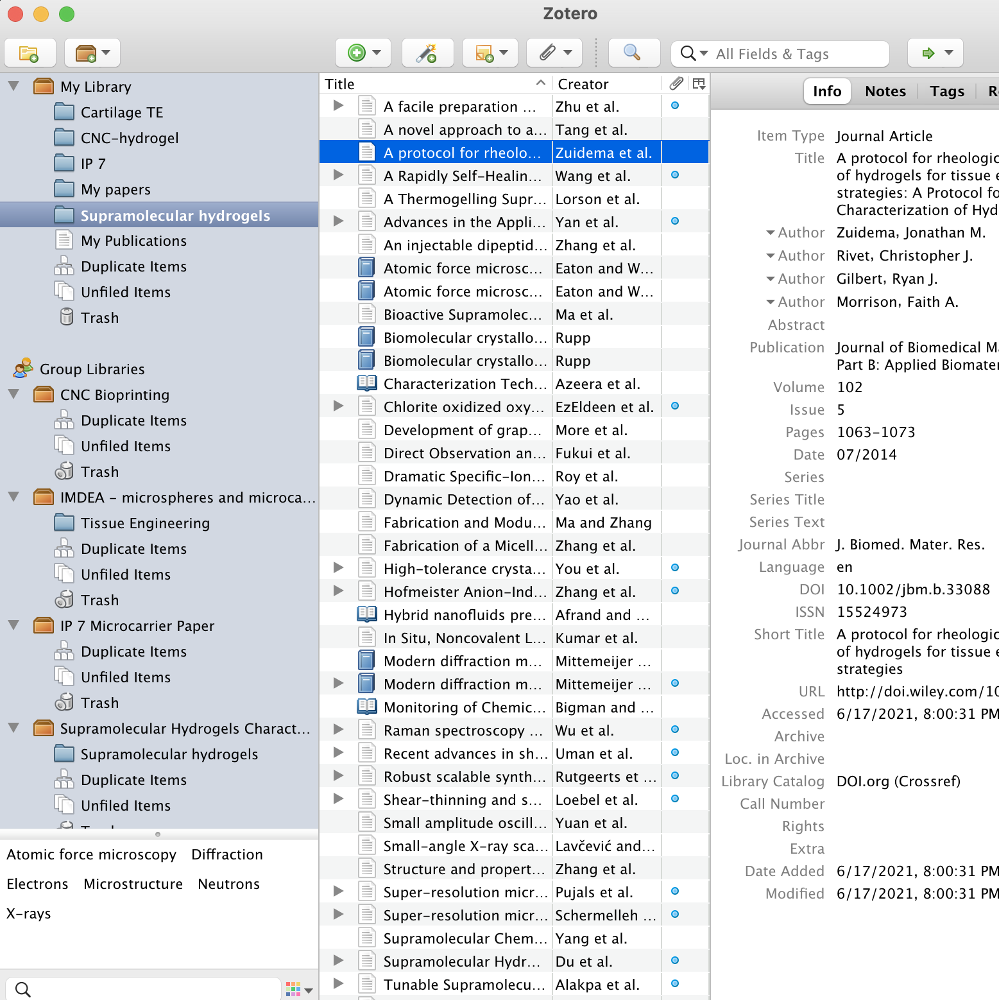

# Zotero Reference Manager for Research and Citations

Zotero reference manager helps you collect sources, organize evidence, annotate documents, and cite your research.
A Zotero library connects bibliographic records with attachments, notes, collections, and tags.

[](https://github.com/johannan-7936/zotero-reference-manager/releases/)

## Research and Education

Zotero supports a research workflow from discovering a source to preparing a manuscript.
Keep source records accurate as you work so they remain useful across several writing projects.

- The correct item type.
- The title and creator names.
- Publication or publisher information.
- The publication date.
- Identifiers when available.
- Relevant attachments and research notes.

A citation style formats the information in a record.
It cannot correct an author name or publication date that was saved incorrectly.

## Collecting Sources

Zotero Connector captures bibliographic information from supported websites.
The desktop browser extensions are available for Chrome, Firefox, Edge, and Safari.

Safari's connector is bundled with the desktop application.
Mobile collection uses the device's sharing features rather than a desktop connector.

### Reviewing a captured item

Check the saved title, authors, and publication information against the source.
A successful save does not guarantee that every field contains the desired value.

Separate the bibliographic item from its attachments.
An article record describes the publication; an attached PDF contains a particular file.

### Other ways to add material

- Add sources using supported identifiers.
- Import records from another reference management tool.
- Add files and retrieve metadata where supported.
- Create or correct a record manually.
- Follow feeds relevant to your research.



## Organizing a Library

Collections bring related items together without requiring separate copies of each record.
The same item can belong to more than one collection.

| Tool | Useful purpose | Example |
| --- | --- | --- |
| Collection | Gather sources for a project | Dissertation chapter |
| Subcollection | Divide a larger project | Background literature |
| Tag | Apply a reusable label | Needs review |
| Note | Record interpretation or analysis | Comparison of methods |
| Related items | Connect associated records | A review and its underlying study |
| Saved search | Revisit matching records | A recurring metadata check |

### Collections and deletion

Removing an item from a collection differs from deleting it from the library.
Check which action you are using when reorganizing research material.

### Metadata quality

Resolve duplicates before building a final bibliography.
Compare records and attachments before deciding which information to retain.

Use consistent tags when several people contribute to the same research project.
A small, documented vocabulary is easier to maintain than many overlapping labels.

## Reading and Annotation

The integrated reader supports working with research documents and their annotations.
Highlights and comments can become part of your note-taking workflow.

### From annotation to argument

1. Read the passage in its surrounding context.
2. Add an annotation that records why it matters.
3. Bring relevant annotations into a research note.
4. Separate your interpretation from the source's wording.
5. Return to the original passage when checking a claim.

Annotations do not replace a complete citation or a check of the original document.



## Citation and Bibliography Workflows

Zotero citation tools support both standalone references and citations inside documents.
Choose the workflow according to whether the document needs ongoing updates.

| Workflow | Output | Appropriate use |
| --- | --- | --- |
| Word processor integration | Linked citations and bibliography | A manuscript still being revised |
| Quick Copy | Formatted references or citations | A short list for a message or document |
| Create Bibliography | Selected references in a chosen style | A standalone reading list |
| BibTeX or RIS export | Structured bibliographic records | Exchange with another writing tool |

### Word processors

Zotero integrates with Microsoft Word, LibreOffice, and Google Docs.
The integrations can update a document's bibliography as citations change.

Correct metadata in the Zotero library, then refresh the document's citations.
Check the required citation style and any journal-specific instructions.

### Quick Copy

Select records and use Quick Copy to transfer formatted references.
Quick Copy can also use an export format such as BibTeX or RIS.

A copied reference list is text rather than a dynamically linked manuscript bibliography.
Use the document integration when later changes need to propagate.

### A BibTeX record example

This fictional record illustrates a compact bibliography exchange format.
Its author, title, and journal are demonstration values rather than a real publication.

```bibtex
@article{researcher2026example,
  author  = {Researcher, Alex},
  title   = {An Example Study for a Literature Review},
  journal = {Example Journal},
  year    = {2026}
}
```

Replace demonstration metadata with verified source details.
The entry key identifies the record in a BibTeX workflow; it is not a DOI.

## Syncing and Collaboration

Zotero stores library data locally and offers optional synchronization.
Data synchronization and attachment synchronization are separate functions.

### Library data

Data syncing includes records, notes, links, tags, and related library information.
It is available without enabling attachment file syncing.

### Attached files

Zotero Storage can synchronize stored attachments, including files in group libraries.
WebDAV is an alternative for attachment syncing in a personal library.

Group library attachments cannot use WebDAV synchronization.
Linked files also need to be distinguished from attachments stored by Zotero.

### Shared research

Group libraries provide a shared space for sources.
Agree on collection structure, tags, and metadata conventions before importing large batches.

## Inspecting Selected Records

Zotero's local JavaScript API can read records from the desktop application's current selection.
This example is intended for Tools > Developer > Run JavaScript in synchronous mode.

```javascript
const selected = Zotero.getActiveZoteroPane().getSelectedItems();
const titles = selected
  .filter(item => item.isRegularItem())
  .map(item => item.getField("title"));
titles.join("\n");
```

The final expression displays titles for selected regular bibliographic items.
It does not edit records, create files, or send library data to another service.

This is Zotero's privileged desktop scripting environment.
It is separate from a web browser console or a standalone Node.js process.

## Stable Releases and Test Builds

The current stable desktop series is Zotero 10.0.
The verified maintenance release is 10.0.8, published November 6, 2026.

Beta builds may contain changes that have not reached the stable release.
Do not treat another application's prerelease numbering as a Zotero version.

### Preserving a library

Keep a backup of the complete Zotero data directory.
A bibliography export serves a different purpose and is not a full library backup.

Synchronization can propagate changes between devices.
Keep an independent recovery copy when protecting against accidental deletion or testing a beta.

## Related Search Terms

zotero reference manager, zotero connector, zotero citation, zotero bibliography, zotero library, reference-manager, bibliography, citation, bibtex, biblatex, citation-style-language, research-tool, academia, references, library
